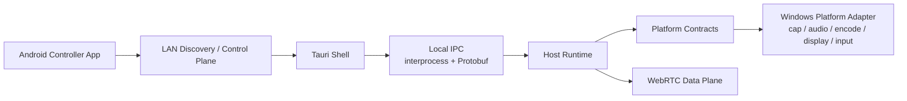
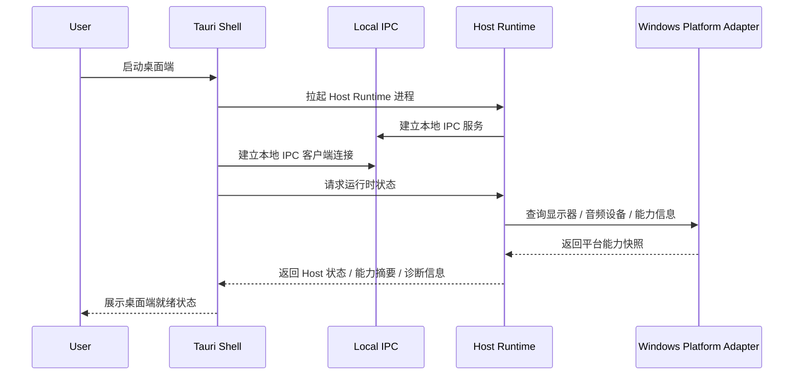
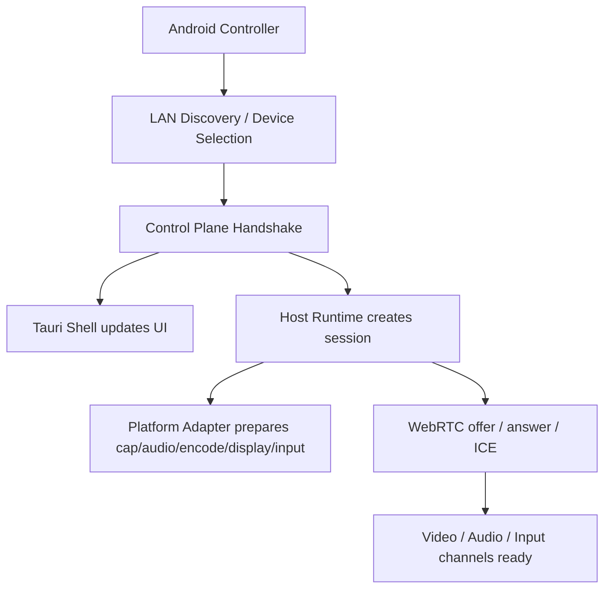
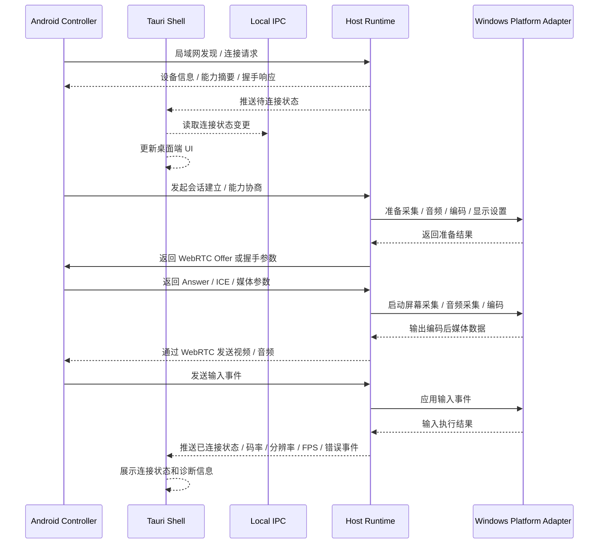
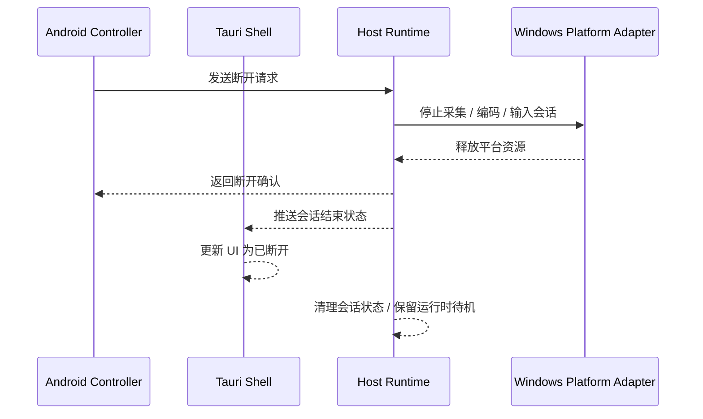
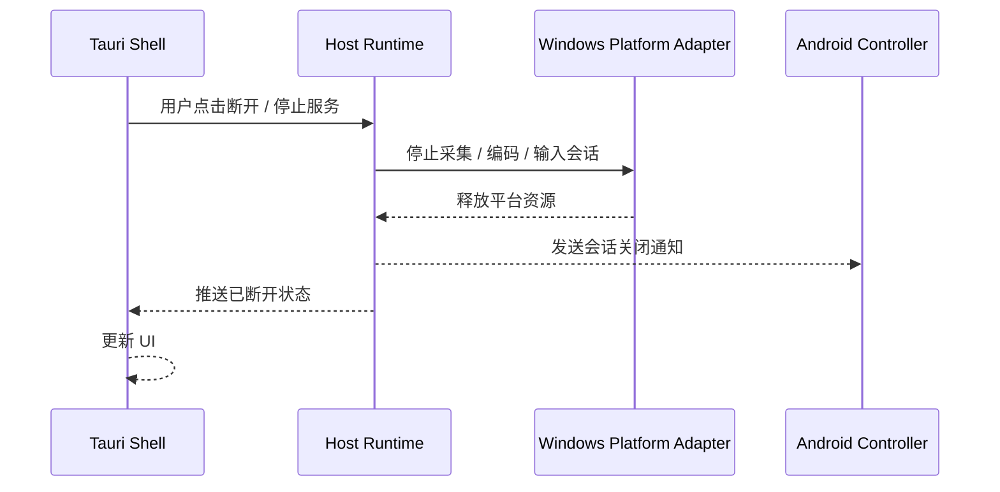
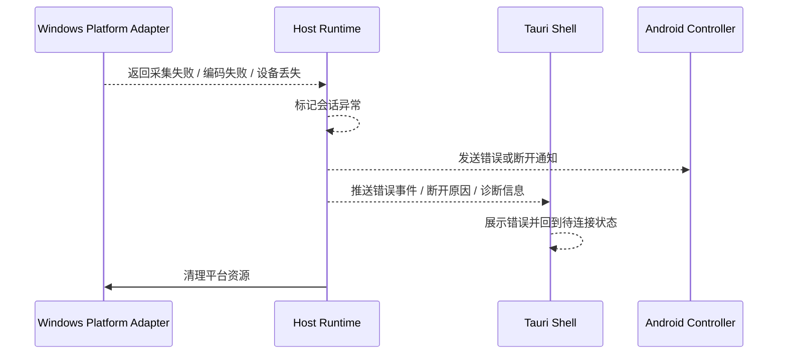
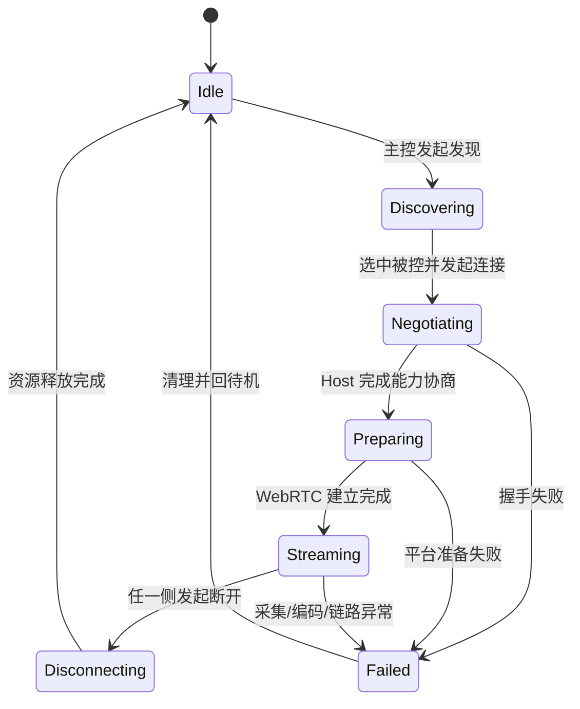
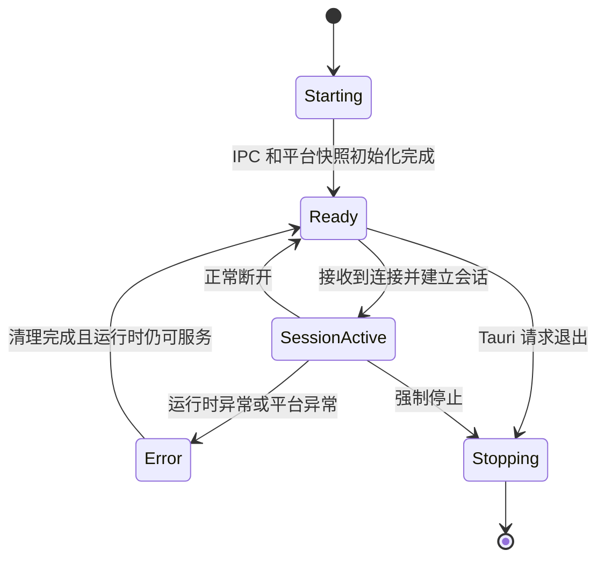

# AkaDesk 数据流转流程图

## 1. 文档目的

本文档只描述运行时数据和控制流，不重复技术选型细节。重点说明：

- 启动过程
- 连接过程：由主控发起到被控
- 断开过程：主控主动断开
- 断开过程：被控主动断开或异常断开

桌面端在本文中明确拆成两部分：

- `Tauri Shell`
- `Host Runtime`

其中：

- `Tauri Shell` 负责 UI、配置、日志展示、拉起和监控 Host
- `Host Runtime` 负责会话、媒体链路、能力编排
- `Windows Platform Adapter` 负责实际平台能力调用

## 2. 运行时参与方

说明：

- Android 不直接和 Tauri UI 交换媒体数据
- Tauri 不进入媒体主链路，只负责本地控制和状态展示
- 平台实际调用发生在 `Windows Platform Adapter`

## 3. 启动过程

### 3.1 启动时序图

### 3.2 启动后的职责边界

- `Tauri Shell`：
  - 拉起 Host
  - 建立本地 IPC
  - 展示状态和日志
- `Host Runtime`：
  - 初始化运行时
  - 加载平台实现
  - 聚合能力快照
- `Windows Platform Adapter`：
  - 查询显示器、音频设备、编码能力
  - 提供平台初始状态

## 4. 连接过程

## 4.1 主控到被控的连接总览

## 4.2 连接时序图

### 4.3 连接阶段的数据流向

- 控制流：
  - `Android Controller -> Host Runtime`
  - `Host Runtime -> Tauri Shell`
- 本地管理流：
  - `Tauri Shell <-> Host Runtime` 通过 `interprocess + Protobuf`
- 媒体流：
  - `Windows Platform Adapter -> Host Runtime -> Android Controller`
- 输入流：
  - `Android Controller -> Host Runtime -> Windows Platform Adapter`

关键原则：

- 媒体流不经过 `Tauri Shell`
- `Tauri Shell` 只消费状态、日志、诊断、配置结果
- `Host Runtime` 负责会话编排，不直接写平台调用细节
- 会话中的“分辨率修改”指目标显示器分辨率修改
- 分辨率修改允许按显示器设置重配 + 采集/编码重配处理，必要时重建链路
- 显示器模式变更应显式区分 `requested_display_mode` 和 `history_display_mode`

## 5. 主控主动断开过程

断开后的预期状态：

- `Host Runtime` 继续存活
- `Tauri Shell` 继续存活
- 平台采集和编码资源被释放
- 显示器模式恢复到 `history_display_mode`
- 桌面端回到待连接状态

## 6. 被控主动断开或异常断开过程

## 6.1 被控主动断开

## 6.2 被控异常断开

异常断开后的处理原则：

- 平台异常先由 `Platform Adapter` 上报
- 会话是否终止由 `Host Runtime` 决定
- UI 呈现和用户提示由 `Tauri Shell` 负责

## 7. 状态图

### 7.1 会话状态图

说明：

- `Idle`：待连接状态
- `Discovering`：发现设备和拉取能力摘要
- `Negotiating`：握手、能力协商、会话建立
- `Preparing`：Host 准备采集、音频、编码、显示设置
- `Streaming`：视频、音频、输入链路已就绪
- `Disconnecting`：进入资源释放和会话清理
- `Failed`：异常中止，等待回收并回待机

### 7.2 Host Runtime 运行状态图

说明：

- `Starting`：Host 进程启动并初始化 IPC 与平台能力
- `Ready`：Host 存活且可接受连接
- `SessionActive`：存在活跃控制/媒体会话
- `Error`：会话或平台异常，但进程仍存活
- `Stopping`：响应 Tauri 退出或停止指令

## 8. 流程与状态映射表

| 流程阶段 | Android Controller | Tauri Shell | Host Runtime | Platform Adapter |
| --- | --- | --- | --- | --- |
| 桌面启动 | 未参与 | `Booting -> Ready` | `Starting -> Ready` | `Initializing -> Ready` |
| 主控发现被控 | `Idle -> Discovering` | `Ready` | `Ready` | `Ready` |
| 主控发起连接 | `Discovering -> Negotiating` | `Ready -> ConnectingView` | `Ready -> Negotiating` | `Ready` |
| Host 准备平台能力 | `Negotiating` | `ConnectingView` | `Negotiating -> Preparing` | `Ready -> Preparing` |
| WebRTC 建立成功 | `Negotiating -> Streaming` | `ConnectingView -> SessionActiveView` | `Preparing -> Streaming` | `Preparing -> Active` |
| 主控发送输入 | `Streaming` | `SessionActiveView` | `Streaming` | `Active` |
| 主控主动断开 | `Streaming -> Disconnecting -> Idle` | `SessionActiveView -> Ready` | `Streaming -> Disconnecting -> Ready` | `Active -> Releasing -> Ready` |
| 被控主动断开 | `Streaming -> Idle` | `SessionActiveView -> Ready` | `Streaming -> Disconnecting -> Ready` | `Active -> Releasing -> Ready` |
| 平台异常断开 | `Streaming -> Failed -> Idle` | `SessionActiveView -> ErrorView -> Ready` | `Streaming -> Failed/Error -> Ready` | `Active -> Error -> Releasing -> Ready` |
| 桌面退出 | 未参与 | `Ready -> Stopping` | `Ready/SessionActive -> Stopping` | `Ready/Active -> Releasing -> Stopped` |

补充说明：

- `ConnectingView`、`SessionActiveView`、`ErrorView` 是 Tauri UI 展示态，不等于 Host 内部会话态。
- `Preparing`、`Active`、`Releasing`、`Error` 是 Adapter 侧资源态，用来描述平台能力的资源占用情况。
- Host Runtime 的 `Ready` 表示“可服务”，不代表一定有活跃会话。

## 9. 关键边界总结

### 9.1 Tauri Shell

负责：

- 拉起和监控 Host
- 建立本地 IPC
- 展示状态、日志、错误、配置

不负责：

- 不转发视频音频主数据
- 不直接调用平台采集或输入 API

### 9.2 Host Runtime

负责：

- 会话状态机
- 协议握手和能力协商
- WebRTC 会话编排
- 聚合平台结果并对外提供稳定服务接口

不负责：

- 不直接调用 Windows/Linux API
- 不承载桌面 UI

### 9.3 Platform Adapter

负责：

- 屏幕采集
- 音频采集
- 编码能力接入
- 输入注入
- 显示器设置读取和应用

不负责：

- 不负责 IPC
- 不负责会话状态机
- 不直接对前端暴露

## 10. 当前实现映射

当前仓库里，这份文档描述的是目标运行流，不是已实现代码事实。当前已落地的仍只有：

- `android/` Android 工程基线
- [技术选型.md](/D:/Project/AkaDesk/docs/技术选型.md:1)

后续真正进入实现时，应优先按本文的边界起下面这些骨架：

- `desktop/host/contracts/`
- `desktop/host/ipc/`
- `desktop/host/runtime/`
- `desktop/host/windows/`
- `desktop/host/windows/input/`
- `desktop/host/linux/`
- `desktop/host/linux/input/`
